# EndoTrack

**Endoso Operations & Customer Tracking Platform for Grupo Pana**

> Web platform for managing vehicle sales through Grupo Pana's _endoso_ channel: a 13-task employee workflow with documents, deadlines and analytics, plus a secure customer portal that shows progress through six clear milestones.

**Status:** 🟡 Design phase: requirements, data model and architecture are being specified. No application code yet.
**Working name:** _EndoTrack_ (proposed, pending approval). **Specification:** [`PROJECT_SPECIFICATION.tex`](./PROJECT_SPECIFICATION.tex)

---

## 1. Executive overview

Grupo Pana is a Peruvian automotive company and an official Toyota and Hino dealership. Part of its vehicle sales run through a channel called **endoso**, where a sale passes through commercial, administrative, financial, documentation, customs, registration, preparation and delivery activities, coordinated between the customer and several Grupo Pana employees.

EndoTrack centralizes each operation, from the official quotation to vehicle delivery, in one traceable record. Each **sale register** represents exactly one vehicle sale and moves through **13 strictly linear tasks**. The platform has two connected experiences:

| Experience                      | Audience                                                                                   | What it does                                                                                                                                                                        |
| ------------------------------- | ------------------------------------------------------------------------------------------ | ----------------------------------------------------------------------------------------------------------------------------------------------------------------------------------- |
| **Employee App** (`/admin`)     | System Admins, Sales Managers, Sales Advisors                                              | Manage customers, vehicle catalog, sale registers, the 13-task process, documents, assignments, notes, reminders/escalations, audit history, exports and a role-aware BI dashboard. |
| **Customer Portal** (`/portal`) | Customers (B2C diplomatic; B2B embassies, religious entities, international organizations) | Securely sign in, see their own sale registers, follow **six customer-friendly milestones**, and open only the fields and documents explicitly marked customer-visible.             |

### Design principles

- **Linear by design:** Task _N_ can start only after Task _N-1_ is completed; at most one task is `in_progress` per sale.
- **Derived, not duplicated:** the customer's current milestone is computed from task statuses and never stored as an editable field.
- **Immutable history:** customer and vehicle-price snapshots are captured at sale creation; significant changes go to an append-only audit trail.
- **Server-side authorization:** roles, customer isolation and document visibility are enforced by the backend, never by the UI alone.
- **Zero-cost prototyping:** every component must have a functional free tier (see below and the specification for caveats).

---

## 2. Tech stack (proposed, zero-cost prototyping)

> These are **technical recommendations, not final decisions**; each will be recorded as an ADR. Free-tier details were checked on 15 Oct 2026 and some sources disagree, so **re-verify provider quotas before relying on them**.

| Layer        | Proposal                                                                                                                                                                                | Free-tier notes and caveats                                                                                                                                                                                                                                               |
| ------------ | --------------------------------------------------------------------------------------------------------------------------------------------------------------------------------------- | ------------------------------------------------------------------------------------------------------------------------------------------------------------------------------------------------------------------------------------------------------------------------- |
| Frontend     | React + TypeScript (Vite), React Router, TanStack Query, Zod                                                                                                                            | Static hosting on Render's free static sites (or an equivalent static host).                                                                                                                                                                                              |
| Backend      | Node.js + Express + TypeScript, **modular monolith**                                                                                                                                    | Render free web service **spins down after ~15 min idle** (~1 min cold start) and shares a monthly instance-hour pool. Unsuitable for in-process cron.                                                                                                                    |
| Database     | PostgreSQL                                                                                                                                                                              | Render's free Postgres **expires** (reported as 30 days + grace; some sources say 90), so it only suits short demos. Candidate for the prototype: a free Postgres such as Supabase (500 MB; projects pause after ~1 week idle) used as plain Postgres.                    |
| Auth         | Own JWT implementation: short-lived access token + rotating refresh token in an HttpOnly, Secure, SameSite cookie; Argon2id hashing                                                     | No vendor lock-in; separate token audiences for employees and customers.                                                                                                                                                                                                  |
| File storage | Storage-provider abstraction. Catalog images: Cloudinary. **Confidential documents (identity, DDC, financial, legal): private bucket with backend-authorized, short-lived signed URLs** | Cloudinary free = 25 credits/month (1 credit ≈ 1 GB storage, 1 GB bandwidth or 1,000 transformations); private delivery works via `authenticated`/`private` types, but token-based expiring URLs are reported as a paid feature and quota exhaustion can suspend serving. |
| Scheduler    | Idempotent `tick` endpoint triggered externally (e.g., GitHub Actions schedule)                                                                                                         | Needed because free web services sleep; also keeps the DB awake.                                                                                                                                                                                                          |
| Email        | Transactional email provider with a free tier (to be evaluated)                                                                                                                         | Outbox table + delivery log for retries and deduplication.                                                                                                                                                                                                                |
| BI           | SQL views + parameterized queries rendered with a chart library in the app                                                                                                              | No separate analytics platform needed for the MVP.                                                                                                                                                                                                                        |

---

## 3. Roles and access (RBAC overview)

| Capability        | System Admin                                              | Sales Manager                                                      | Sales Advisor                                                        | Customer                               |
| ----------------- | --------------------------------------------------------- | ------------------------------------------------------------------ | -------------------------------------------------------------------- | -------------------------------------- |
| Staff accounts    | Full CRUD                                                 | View active advisors (for reassignment)                            | None                                                                 | None                                   |
| Vehicle catalog   | Full CRUD                                                 | Create/edit models and versions, upload photos, archive            | Read-only                                                            | Sees own vehicle only                  |
| Customers         | Full CRUD (exceptional hard delete)                       | View/edit/create any; no hard delete                               | Create; view/edit only customers tied to own sales                   | Own record, read-only                  |
| Sale registers    | Full CRUD; delete corrupted/test records under safeguards | View all, reassign, cancel any, undo cancellation                  | Create/update/cancel own (reason required); cannot undo cancellation | Own sales, read-only                   |
| Tasks & documents | Full (exceptional intervention)                           | Override all tasks, edit/replace files, reopen last completed task | Update own **active** tasks; completed tasks read-only               | Customer-visible fields/documents only |
| BI dashboard      | Global                                                    | Global business/operational                                        | Own pipeline and permitted metrics                                   | None                                   |
| Raw exports       | Full, incl. audit/access logs                             | Business exports (customers, sales, task audit, cancellations)     | None                                                                 | None                                   |

Authentication uses **document type + document number + password** (not email) on two separate login interfaces, `/admin` (DNI, CE, PAS) and `/portal` (DNI, CE, RUC, PAS, CDI), with all identity, role and resource checks enforced server-side.

---

## 4. Process flow: 13 internal tasks → 6 customer milestones

`✉` marks tasks whose completion triggers a customer email. `SLA` is the recommended duration (strict elapsed calendar time, starting when the task becomes `in_progress`).

```mermaid
flowchart TB
    START(["Sale register created<br/>13 tasks created as pending"])

    subgraph M1["Milestone 1 · Cotización y Documentación"]
        T1["T1 · Cotización del Vehículo ✉"]
        T2["T2 · Debida Diligencia del Cliente<br/>SLA 3 d"]
        T1 --> T2
    end

    subgraph M2["Milestone 2 · Asignación y Pago"]
        T3["T3 · Liquidación de Unidad ✉<br/>SLA 12 d"]
        T4["T4 · Pago a Grupo Pana"]
        T3 --> T4
    end

    subgraph M3["Milestone 3 · Facturación Oficial"]
        T5["T5 · Pago a Toyota"]
        T6["T6 · Facturación ✉"]
        T5 --> T6
    end

    subgraph M4["Milestone 4 · Trámites Aduaneros"]
        T7["T7 · Documentos Endosados ✉<br/>SLA 10 d"]
        T8["T8 · Trámite Aduanero<br/>SLA 12 d"]
        T7 --> T8
    end

    subgraph M5["Milestone 5 · Liberación y Placas"]
        T9["T9 · Trámite de Liberación<br/>SLA 30 d"]
        T10["T10 · Inmatriculación y Placas ✉<br/>SLA 15 d"]
        T9 --> T10
    end

    subgraph M6["Milestone 6 · Preparación y Entrega"]
        T11["T11 · Traslado a PDS ✉"]
        T12["T12 · Equipamiento"]
        T13["T13 · Entrega de Vehículo ✉"]
        T11 --> T12 --> T13
    end

    FINISH(["Sale state = completed<br/>(automatic when all 13 tasks are completed)"])

    START --> T1
    T2 --> T3
    T4 --> T5
    T6 --> T7
    T8 --> T9
    T10 --> T11
    T13 --> FINISH

    style M1 fill:#e8f0fe,stroke:#1f3a5f
    style M2 fill:#e6f4ea,stroke:#1e6b3a
    style M3 fill:#fff4e5,stroke:#b26a00
    style M4 fill:#fce8e6,stroke:#b3261e
    style M5 fill:#f3e8fd,stroke:#6a1b9a
    style M6 fill:#e0f7fa,stroke:#006064
```

**Milestone state is derived:** a milestone is `completed` when all its tasks are completed, `in_progress` when it contains the single active task, otherwise `pending`. The overall sale state (`active`, `completed`, `cancelled`) is shown separately.

Beyond the task-completion emails marked above, customers also receive an account-creation email (once per customer) and a "sale register created" email.

---

## 5. Roadmap (high level)

| Phase | Focus                                                                                                                        |
| ----- | ---------------------------------------------------------------------------------------------------------------------------- |
| 1     | **Employee side:** auth/RBAC, reference data, customers, catalog, sale registers, 13-task workflow, documents, audit history |
| 2     | **Customer side:** portal, isolation, six-milestone experience, customer-visible data/documents, milestone emails            |
| 3     | **Automation:** scheduler, reminders/escalations, deduplication, notification logs, task-timing analytics                    |

The order is a starting point and will be revisited as dependencies and risks become clear.

---

## 6. Repository documentation

| Document                                                   | Purpose                                                                |
| ---------------------------------------------------------- | ---------------------------------------------------------------------- |
| [`PROJECT_SPECIFICATION.tex`](./PROJECT_SPECIFICATION.tex) | Software Requirements & Product Specification (baseline v0.1)          |
| `docs/adr/` _(planned)_                                    | Architecture decision records                                          |
| `docs/` _(planned)_                                        | ERD, API reference, security model, testing strategy, operations guide |

---

## 7. Getting started

Implementation has not started. Local development instructions will be added when Phase 1 begins.

## 8. License

To be defined by the repository owner.
