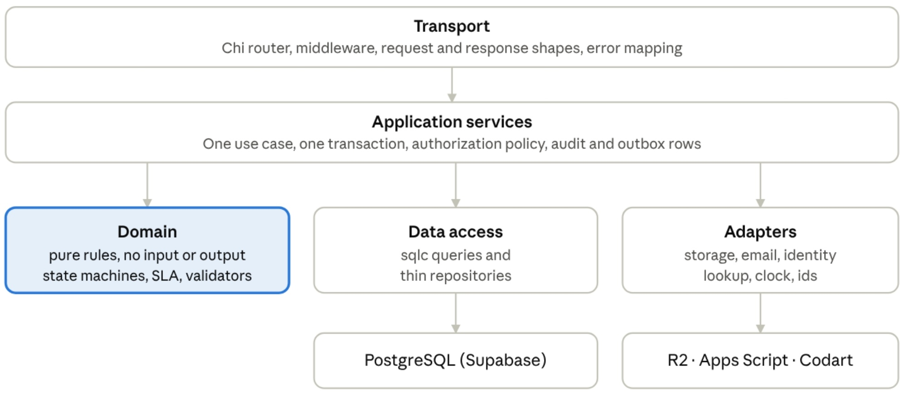

# EndosoFlow — Architecture & API Contract

## 1. Status and how to read

This document proposes how the application is built: the backend layers and modules, the **project structure**, the technical choices behind it, the API conventions and the Phase 1 API surface. It builds on the State Machines & Permissions Spec, Requirements Catalog, IA & Journeys and Data Model.

## 2. Architecture in one page

A **modular monolith**: one Go service, one deployable, internally divided into modules with clear boundaries. For a small team and a free-tier host this is simpler, cheaper and easier to test than microservices, and the module boundaries keep a later split possible.

Each module follows the same five layers, and dependencies point inward:

1. **Transport** (HTTP): the Chi router, middleware, request and response shapes, and the mapping of errors to HTTP responses. No business rules.
2. **Application services:** one method per use case. A service opens a database transaction, checks authorization, orchestrates the other layers and writes audit and outbox rows.
3. **Domain:** pure Go code with no input or output: the task and sale state machines, SLA calculations, milestone derivation, validators (identifier formats, formulas) and the authorization policy tables. This is where most unit tests live.
4. **Data access:** type-safe SQL written by hand and turned into Go code by `sqlc`, wrapped in thin repositories. Queries take the acting user’s scope, so out-of-scope rows never leave the database.
5. **Adapters** behind small interfaces: object storage (R2), email sender (Apps Script), identity lookup (Codart), clock and id generator. Tests replace them with fakes.

The rule that keeps this healthy: the domain imports nothing from the other layers, and services depend on interfaces, never on a vendor SDK.



Services call the domain for decisions and data access for persistence; the transport layer only ever talks to services.

## 3. Backend modules

| Module          | Owns (tables)                                                                | Responsibilities                                                                                    | Depends on                                                |
| --------------- | ---------------------------------------------------------------------------- | --------------------------------------------------------------------------------------------------- | --------------------------------------------------------- |
| `platform`      | none                                                                         | Configuration, logging, database pool and transaction helper, middleware, error types, ids, clock   | nothing                                                   |
| `auth`          | refresh tokens, `account_tokens`, `access_logs`                              | Employee login, token issue and rotation, activation, password reset, lockout, access logging       | `staff`, `notifications`                                  |
| `staff`         | `employees`                                                                  | Staff accounts, roles, deactivation rules, last-Admin protection, photos                            | `audit`, `documents` (storage helpers)                    |
| `customers`     | `customers`, `lookup_logs`                                                   | Customers, existence lookup, Codart autofill with the quota guard                                   | `audit`                                                   |
| `catalog`       | models, versions, colors, images, categories                                 | Catalog CRUD, atomic model creation, archiving, selectable-vehicle query                            | `audit`                                                   |
| `sales`         | `sale_registers`                                                             | Sale creation with snapshots, reassignment, cancel and reopen, controlled deletion                  | `tasks`, `customers`, `catalog`, `audit`, `notifications` |
| `tasks`         | `task_instances`, financials, due diligence, payments, invoices, fulfillment | The task engine (start, complete, restart, reopen, edit), per-task validation, milestone derivation | `documents`, `audit`, `notifications`                     |
| `documents`     | `documents`, `storage_deletions`                                             | Upload, replace, remove, signed downloads, storage cleanup                                          | `audit`                                                   |
| `audit`         | `audit_logs`                                                                 | Audit writer used by every module, history queries                                                  | nothing                                                   |
| `notifications` | `notification_logs`                                                          | Outbox rows, email sending through the port, retries                                                | nothing                                                   |
| `search`        | none (reads other tables)                                                    | Global search within the user’s scope                                                               | `sales`, `customers` read models                          |
| `reference`     | definitions and enum labels                                                  | One endpoint serving enums, Spanish labels, task and milestone definitions, document slots          | nothing                                                   |

A module never reads another module’s tables directly; it calls that module’s service. The exceptions are the read-only `search` queries and the shared milestone view.

## 4. Proposed project structure

One repository (monorepo) named `grupo-pana-endoso`:

```
grupo-pana-endoso/
├── backend/
│   ├── cmd/api/                 main: wiring, config, server start
│   ├── internal/
│   │   ├── platform/            config, logging, db pool, tx helper, middleware, errors
│   │   ├── auth/  staff/  customers/  catalog/
│   │   ├── sales/  tasks/  documents/
│   │   ├── audit/  notifications/  search/  reference/
│   │   └── adapters/            r2/  appsscript/  codart/
│   ├── db/
│   │   ├── migrations/          versioned SQL files
│   │   ├── queries/             sqlc query files, one folder per module
│   │   └── seeds/               reference data
│   ├── api/openapi.yaml         the API contract (source of truth)
│   ├── sqlc.yaml
│   └── tests/                   integration and API tests
├── frontend/
│   └── src/
│       ├── app/                 shell, routing, providers
│       ├── features/            auth/ sales/ tasks/ customers/ catalog/ staff/ documents/ search/
│       ├── shared/              api client, ui components, i18n (es), hooks, utils
│       └── tests/               unit and end-to-end tests
├── docs/                        decision log and exported specs
├── .github/workflows/           CI
├── Makefile                     local setup commands
└── README.md
```

Inside each backend module the same small set of files repeats, so any module is easy to read once you know one:

- `handler.go`: HTTP handlers and request or response mapping.
- `service.go`: the use cases and transaction boundaries.
- `policy.go`: who may do what (the permission matrix as code).
- `domain/`: pure rules and types, with tests.
- `repository.go`: wrappers over the generated query code.
- `*_test.go`: tests next to the code.

## 5. Technical choices

| Area                 | Choice                                                                                                                       | Why                                                                                                                                                                    |
| -------------------- | ---------------------------------------------------------------------------------------------------------------------------- | ---------------------------------------------------------------------------------------------------------------------------------------------------------------------- |
| HTTP router          | Chi v5                                                                                                                       | Small, standard-library style, and already in your stack.                                                                                                              |
| Database access      | `pgx` v5 with a pool, plus `sqlc`                                                                                            | SQL stays visible and reviewable, queries are type-checked at build time, and there is no ORM hiding behaviour. Fits the heavy use of constraints and partial indexes. |
| Migrations           | `goose` with plain SQL files                                                                                                 | Simple, forward-only, and runs in CI.                                                                                                                                  |
| API contract         | OpenAPI 3.1 written first, then a generated Go server interface and a generated TypeScript client                            | The backend and frontend cannot drift apart, and the contract is reviewable before any code.                                                                           |
| Passwords and tokens | `x/crypto/argon2` for Argon2id; `golang-jwt` v5 for access tokens; random opaque refresh tokens stored as hashes             | As decided.                                                                                                                                                            |
| IDs                  | `google/uuid` generating UUIDv7                                                                                              | Time-ordered keys.                                                                                                                                                     |
| Logging              | The standard `log/slog` in JSON with a request id                                                                            | No extra dependency; no secrets or personal data in logs.                                                                                                              |
| Configuration        | Environment variables read into one typed struct at startup, failing fast when something is missing                          | Predictable on Render.                                                                                                                                                 |
| Backend tests        | Go `testing`, table-driven tests for the domain, a real local PostgreSQL (a separate test database) for integration tests    | Constraints, triggers and partial indexes must be tested against a real database.                                                                                      |
| Frontend             | React 18, Vite, TypeScript, React Router, TanStack Query for server data, React Hook Form with Zod for forms, Recharts later | Standard, well supported, and a good fit for form-heavy screens.                                                                                                       |
| UI kit               | Tailwind CSS with shadcn/ui components                                                                                       | Accessible building blocks you own and can restyle.                                                                                                                    |
| Spanish text         | One typed dictionary and a tiny `t()` helper                                                                                 | A full i18n library is unnecessary for one language, and keys keep a later switch possible.                                                                            |
| Frontend tests       | Vitest and Testing Library; Playwright for end-to-end                                                                        | Covers forms and the critical journeys.                                                                                                                                |
| Quality gates        | `golangci-lint`, `go vet`, ESLint, TypeScript strict mode                                                                    | Catches mistakes before review.                                                                                                                                        |

## 6. Request pipeline and security

Every request passes the same steps in order:

1. Assign a request id and recover from panics.
2. Log the request (method, path, status, duration, request id; no bodies).
3. Apply security headers and rate limits (stricter on login and lookup endpoints).
4. Verify the access token (signature and expiry).
5. Load the employee and check, in the database, that the account is active and the role matches the token (confirmed rule).
6. Run the endpoint’s authorization policy (default deny).
7. Call the handler, which calls one service method inside one transaction.
8. Map errors to the standard error shape.

**Cookies and CSRF.** The refresh token travels only in an HttpOnly, Secure cookie scoped to the auth path. Because the frontend reaches the API through the same-origin `/api` proxy, the cookie can use `SameSite=Strict`. Refresh and logout also require a custom request header and an origin check as a second defence. The access token stays in memory; on a 401 the client refreshes once and retries.

**Authorization as code.** Each module’s `policy.go` mirrors the permission matrix: a function that takes the actor, the action and the resource facts and answers allow or deny. Repository queries also take the actor’s scope (for example the advisor id), so an advisor asking for another advisor’s sale gets ‘not found’, never ‘forbidden’, and nothing leaks. The authorization tests are generated from the matrix, one case per role and action.

## 7. Transactions, concurrency and side effects

- **One use case, one transaction.** Anything that changes a sale first takes a row lock on that sale (`SELECT ... FOR UPDATE`), which serializes concurrent transitions.
- **Optimistic locking.** Editable resources return a `version` (the row version). Updates must send the version they read; a mismatch returns a 409 ‘modified by someone else’ response and the client reloads.
- **Repeat safety without idempotency keys.** Transition endpoints (start, complete, restart, reopen) state the expected current status. A double click finds the status already changed and returns a clean conflict, so the transition applies once.
- **Outbox pattern for side effects.** Emails and stored-file deletions are written as rows (`notification_logs`, `storage_deletions`) inside the same transaction as the business change. After the commit, the backend processes them; the hourly job retries what failed. If the process dies, nothing is lost and nothing is sent twice (unique dedupe keys).
- **Audit in the same transaction.** The audit row is written with the change, so a change without its audit entry cannot commit.

## 8. API conventions

- **Base path and versioning:** `/api/v1`, JSON over HTTPS, one resource style across modules.
- **Naming:** camelCase fields (P); identifiers are UUID strings; timestamps are ISO 8601 in UTC; calendar dates are `YYYY-MM-DD`.
- **Money:** a string with two decimals, for example `"1250.50"`, never a floating-point number.
- **Lists:** `page` and `pageSize` (default 20, maximum 100) with a total count, `sort` (for example `-createdAt`) and plain filter parameters. Offset paging is enough at this scale and supports jumping to a page.
- **Status codes:** 200 and 201 for success; 400 for malformed requests; 401 for no or expired credentials; 403 when the record is visible but the action is not allowed; 404 for missing or out-of-scope records; 409 for version, state and uniqueness conflicts; 422 for rule violations; 429 for rate limits.
- **Error shape:**

```
{ "error": { "code": "TASK_FINANCIAL_FIELD_LOCKED",
    "message": "Bloqueado: hay tareas posteriores completadas.",
    "fields": [ { "field": "accessoryAmount", "code": "LOCKED", "message": "..." } ],
    "requestId": "..." } }
```

Codes are stable English constants; messages are Spanish and safe to show. The error catalog (about 40 codes, grouped by module) is part of the OpenAPI file.

- **Warnings:** successful saves may return `warnings` (for example an out-of-order date) that never block.
- **Task data:** one endpoint per task, with a payload schema per task number; the response returns the saved data, calculated values (quoted price, final commission, expected amounts) and warnings.
- **Reference data:** the interface asks `/reference` once for enums, Spanish labels, definitions and document slots, so labels are never hard-coded twice.
- **Uploads:** `multipart/form-data`, streamed to storage; size and type are checked before and after.

## 9. Phase 1 API surface

All paths are under `/api/v1`. “Any staff” means Admin, Manager and Advisor; every sale or customer route is further limited by scope.

| Area      | Method and path                                                                          | Purpose                                                                                       | Roles                      |
| --------- | ---------------------------------------------------------------------------------------- | --------------------------------------------------------------------------------------------- | -------------------------- |
| Auth      | `POST /auth/employee/login`                                                              | Log in                                                                                        | Public                     |
| Auth      | `POST /auth/refresh`, `POST /auth/logout`                                                | Rotate the session, log out                                                                   | Any staff                  |
| Auth      | `POST /auth/activate`                                                                    | Set the first password from the link                                                          | Public (token)             |
| Auth      | `POST /auth/forgot-password`, `POST /auth/reset-password`                                | Recovery flow                                                                                 | Public                     |
| Auth      | `GET /me`, `PUT /me/password`                                                            | Own profile, change password                                                                  | Any staff                  |
| Staff     | `GET /employees`, `POST /employees`                                                      | List, create                                                                                  | Admin                      |
| Staff     | `GET /employees/{id}`, `PATCH /employees/{id}`                                           | Read, edit (including role)                                                                   | Admin                      |
| Staff     | `POST /employees/{id}/deactivate`, `/reactivate`, `/resend-activation`                   | Lifecycle                                                                                     | Admin                      |
| Staff     | `DELETE /employees/{id}`                                                                 | Exceptional permanent delete                                                                  | Admin                      |
| Staff     | `PUT /me/photo`, `GET /employees/{id}/photo`                                             | Photo upload, removal (DELETE on the same path), signed photo URL                             | Any staff                  |
| Staff     | `GET /advisors`                                                                          | Active advisors for pickers                                                                   | Admin, Manager             |
| Customers | `GET /customers`, `POST /customers`                                                      | List, create                                                                                  | Any staff                  |
| Customers | `GET /customers/{id}`, `PATCH /customers/{id}`                                           | Read, edit                                                                                    | Any staff (scope)          |
| Customers | `POST /customers/{id}/deactivate`, `/reactivate`                                         | Lifecycle                                                                                     | Admin, Manager             |
| Customers | `DELETE /customers/{id}`                                                                 | Exceptional permanent delete                                                                  | Admin                      |
| Customers | `GET /customers/lookup`                                                                  | Existence lookup by document (legal name only for unlinked advisors)                          | Any staff                  |
| Customers | `GET /lookups/identity`, `GET /lookups/identity/quota`                                   | Codart autofill; remaining quota                                                              | Any staff; Admin           |
| Catalog   | `GET /vehicle-models`, `GET /vehicle-models/{id}`                                        | Browse                                                                                        | Any staff                  |
| Catalog   | `POST /vehicle-models`                                                                   | Create a model with its first version, color and Main image in one request                    | Admin, Manager             |
| Catalog   | `PATCH /vehicle-models/{id}`, `POST .../archive`, `.../unarchive`                        | Edit, archive                                                                                 | Admin, Manager             |
| Catalog   | `POST /vehicle-models/{id}/versions`, `PATCH /vehicle-versions/{id}`, `POST .../archive` | Versions                                                                                      | Admin, Manager             |
| Catalog   | `POST /vehicle-models/{id}/colors`, `PATCH /vehicle-colors/{id}`, `POST .../archive`     | Colors                                                                                        | Admin, Manager             |
| Catalog   | `PUT /vehicle-colors/{id}/images/{viewpoint}`                                            | Upload, replace or remove an image (DELETE on the same path; the Main view cannot be removed) | Admin, Manager             |
| Catalog   | `GET /catalog/selectable`                                                                | Active model, version and color choices for the sale form                                     | Any staff                  |
| Sales     | `GET /sales`, `POST /sales`                                                              | Workspace list, create                                                                        | Any staff (scope)          |
| Sales     | `GET /sales/{id}`, `PATCH /sales/{id}`                                                   | Detail with progress and milestones, edit notes                                               | Any staff (scope)          |
| Sales     | `POST /sales/{id}/reassign`                                                              | Reassign advisor                                                                              | Admin, Manager             |
| Sales     | `POST /sales/{id}/cancel`, `POST /sales/{id}/reopen`                                     | Cancel, reopen (stage rules)                                                                  | Per rules                  |
| Sales     | `DELETE /sales/{id}`                                                                     | Controlled permanent deletion                                                                 | Admin                      |
| Sales     | `GET /sales/{id}/history`                                                                | Audit timeline                                                                                | Per visibility             |
| Tasks     | `GET /sales/{id}/tasks`, `GET /sales/{id}/tasks/{n}`                                     | Task list and detail                                                                          | Any staff (scope)          |
| Tasks     | `PATCH /sales/{id}/tasks/{n}/data`                                                       | Save draft fields (a reason is required on a completed task)                                  | Task actor; Manager, Admin |
| Tasks     | `POST /sales/{id}/tasks/{n}/start`, `/complete`                                          | Transitions                                                                                   | Task actor                 |
| Tasks     | `POST /sales/{id}/tasks/{n}/restart`, `/reopen`                                          | Rollbacks, with a reason                                                                      | Manager, Admin             |
| Tasks     | `PATCH /sales/{id}/tasks/{n}/notes`                                                      | Task notes                                                                                    | Task actor                 |
| Documents | `GET /sales/{id}/documents`                                                              | Slots and their current files                                                                 | Any staff (scope)          |
| Documents | `PUT /sales/{id}/tasks/{n}/documents/{slot}`                                             | Upload or replace                                                                             | Task actor; Manager, Admin |
| Documents | `DELETE /sales/{id}/tasks/{n}/documents/{slot}`                                          | Remove (task in progress only)                                                                | Task actor                 |
| Documents | `GET /documents/{id}/download-url`                                                       | Short-lived signed URL                                                                        | Per matrix                 |
| Search    | `GET /search?q=`                                                                         | Global search                                                                                 | Any staff (scope)          |
| Reference | `GET /reference`                                                                         | Enums, labels, definitions, slots                                                             | Any staff                  |
| System    | `GET /health`                                                                            | Liveness and database check                                                                   | Public                     |

Phase 3 adds the scheduler endpoints (authenticated with a secret, not a user), BI, exports and the log viewers; Phase 2 adds the customer portal routes under a separate path prefix.

## 10. Quality, environments and delivery

**Tests (Phase 1).**

- Domain: table-driven unit tests for every state-machine transition, SLA calculation and validator.
- Integration: each row of the Data Model’s rule map is tested against a real PostgreSQL, including the negative cases (a second in-progress task, a duplicate invoice number, a color from another model).
- API: the authorization matrix, one test per role and action, plus the error shapes.
- End to end (Playwright): the journeys J1 to J9 from the IA document.

**Environments.** Local (PostgreSQL installed locally with Homebrew on Mac or with the apt package manager on Ubuntu), then one deployed environment on the free tiers. A separate production environment is created when you decide to leave the free tier. Non-production environments send emails only to an allow-list.

**Delivery.** Short-lived branches into `main`; every pull request runs lint, tests (the CI runner provides its own temporary PostgreSQL), build, a migration check and an OpenAPI compatibility check; merging to `main` deploys automatically. Migrations are forward-only SQL; a bad migration is fixed with a new one.
