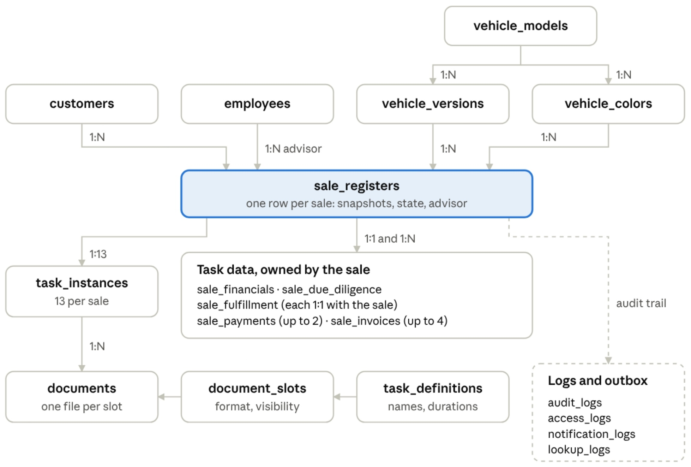

# EndosoFlow — Data Model

## 1. Description of this document

This is the application relational data model, built from the master prompt’s section 16 after a critical review against everything decided so far (State Machines & Permissions Spec, Requirements Catalog, IA & User Journeys). It describes tables, columns, constraints, indexes and relationships in prose and tables.

## 2. What changes from the section 16 proposal

| #   | Change                                                                                                                                                                                                                               | Why                                                                                                                                                                                                                                                       |
| --- | ------------------------------------------------------------------------------------------------------------------------------------------------------------------------------------------------------------------------------------ | --------------------------------------------------------------------------------------------------------------------------------------------------------------------------------------------------------------------------------------------------------- |
| 1   | `sale_operation_details` (about 45 nullable columns) is split into `sale_financials`, `sale_due_diligence`, `sale_payments`, `sale_invoices` and `sale_fulfillment`                                                                  | Invoice numbers need two uniqueness namespaces and payments need two uniqueness spaces; neither can be enforced with per-column constraints in one wide row. Each table also maps to the tasks that own it, which keeps lock and validation rules simple. |
| 2   | Payments and invoices are rows that store an `expected_amount` snapshot next to the entered amount                                                                                                                                   | “Amount differs, so a Mismatch Reason is required” becomes a database CHECK, and the reconciliation stays reproducible.                                                                                                                                   |
| 3   | `quoted_final_price` and `final_commission` become generated columns                                                                                                                                                                 | They can never drift from their inputs, and a Task 1 correction recalculates them automatically.                                                                                                                                                          |
| 4   | New reference tables `task_definitions`, `milestone_definitions` and `document_slots`, with `description_es` on the first two. Banks, customs offices and vehicle categories become native enums                                     | Names, durations, intervals, milestones, descriptions and document rules live in one place, and `task_name` leaves `task_instances`. The three short lists rarely change, so enums keep the model smaller; a new value is one small migration.            |
| 5   | `task_instances` gains `eligible_at`, `approaching_warning_sent_at` and `row_version`. `recurring_reminder_count` becomes `overdue_reminder_count` (0–6). The stored `current_reminder_phase` is dropped                             | The first overdue reminder counts as 1, so the old name was misleading. The phase is fully derivable from the counters, and storing both invites contradictions.                                                                                          |
| 6   | `sale_registers` gains `customer_type_snapshot`, `vehicle_model_id`, `completed_at`, `cancelled_at`, `cancelled_by`, `cancelled_at_task_number`, cancellation category and text, and `row_version`                                   | The customer type decides Task 2’s document rule. The model id enables composite foreign keys (a color must belong to the version’s model). The cancellation fields drive the reopen authority rule and the SLA shift on reopening.                       |
| 7   | `customers` and `employees`: `password_hash` is nullable, `activated_at` replaces `must_change_password`, and `failed_login_count` plus `locked_until` are added                                                                     | Activation links replace temporary passwords. Lockout state needs a home: a failure count, the start of the current 15-minute failure window (first_failed_login_at) and the end of the lock. Five failures inside one window lock the account.           |
| 8   | New `account_tokens` table                                                                                                                                                                                                           | Single-use activation and password-reset links for both account types.                                                                                                                                                                                    |
| 9   | Refresh-token tables gain `family_id`, `parent_token_id`, `remember_me`, `absolute_expires_at`, `rotated_at`, `revoked_at` and `revoked_reason`                                                                                      | Rotation, reuse detection, the 90-day cap and the 10-second grace window need state.                                                                                                                                                                      |
| 10  | Model categories use a join table (`vehicle_model_categories`) holding a `vehicle_category` enum                                                                                                                                     | A real many-to-many with enforced values and no extra reference table; filterable and good for BI.                                                                                                                                                        |
| 11  | `documents` holds only the current file of each slot: `slot_code`, `checksum_sha256`, a composite foreign key to the task and sale, and a unique index on `(task_instance_id, slot_code)`. No archived rows and no replacement chain | Simpler, and sensitive files that are no longer needed are not kept. Customer visibility is derived from the slot definition, never stored per file, so it cannot drift.                                                                                  |
| 12  | `audit_logs`: nullable actor plus a system flag, a denormalized `sale_id`, no foreign keys to business tables, a reason CHECK, short event verbs (CREATED, COMPLETED, REMOVED, …) checked against the entity type                    | Advisors may only see history of their own sales, which needs a fast sale filter. Audit rows must survive deletions, and with no document history the audit log is the record of who changed a file.                                                      |
| 13  | `notification_logs` becomes a transactional outbox: `pending` status, unique `dedupe_key`, recipient ids, attempt count and last error                                                                                               | No lost emails if the process dies, and no duplicates when runs overlap.                                                                                                                                                                                  |
| 14  | New `lookup_logs` table                                                                                                                                                                                                              | Codart quota counting (110 per month) and the logging of existing-customer lookups.                                                                                                                                                                       |
| 15  | A system actor row in `employees`                                                                                                                                                                                                    | Seeded records need an explicit actor, and the first Admin needs a creator.                                                                                                                                                                               |
| 16  | New `storage_deletions` table                                                                                                                                                                                                        | An outbox that deletes replaced or removed files from storage after the database change commits, and retries failures, so no orphaned files remain.                                                                                                       |
| 17  | Invoice numbers use two partial unique indexes: Toyota invoices among themselves, and commission, accessories and release-processing invoices across those three kinds, both including cancelled sales                               | Matches how the numbers are issued, and cancelled sales never release a number. `UNIQUE (sale_id, invoice_kind)` stays.                                                                                                                                   |

## 3. Conventions

- **Names:** snake\_case, plural table names, English identifiers; Spanish text lives in label columns of reference tables and in the UI.
- **Keys:** UUID primary keys generated by the backend as UUIDv7, which are time-ordered and kinder to indexes than random UUIDs. Reference tables use short natural text codes.
- **Time:** `timestamptz` in UTC and `date` for calendar dates; conversion to America/Lima only at the edges.
- **Money:** `numeric(12,2)`, USD only, with CHECK greater than zero.
- **Normalization:** document numbers, series, VIN, plate, invoice and transaction numbers are stored upper-case, trimmed and without inner spaces, with a CHECK that the stored value equals its normalized form; emails are lower-case.
- **Enumerations:** native Postgres enums for closed sets; reference tables where the list is data.
- **Deletes:** foreign keys are `ON DELETE RESTRICT` by default. Cascades run only from `sale_registers` to the rows it owns. `notification_logs` uses `SET NULL`. Audit and access logs keep plain ids with no foreign keys to mutable tables, so they survive any deletion.
- **Lifecycle:** employees, customers, models, versions and colors use `is_active`, `deactivated_at` and `deactivated_by` with a CHECK that an inactive row has a timestamp.
- **Provenance:** `created_by/at` and `updated_by/at` on every business table.
- **Concurrency:** an integer `row_version` on tables users edit (sales, tasks, details, customers, employees, catalog), incremented on every update and checked by the backend.
- **Search:** extensions `pg_trgm` and `unaccent`; trigram indexes on accent-stripped, lower-case names and identifiers.

## 4. Table catalog

### 4.0 Enumerations

| Enum                     | Values                                                                                                                       |
| ------------------------ | ---------------------------------------------------------------------------------------------------------------------------- |
| `employee_role`          | system\_admin, sales\_manager, sales\_advisor                                                                                |
| `employee_document_type` | DNI, CE, PAS                                                                                                                 |
| `customer_document_type` | DNI, CE, PAS, CDI, RUC                                                                                                       |
| `customer_type`          | diplomatico, embajada, entidad\_religiosa\_catolica, entidad\_religiosa\_no\_catolica, organismo\_internacional              |
| `gender`                 | M, F                                                                                                                         |
| `sale_temperature`       | hot, warm, cold                                                                                                              |
| `sale_state`             | active, completed, cancelled                                                                                                 |
| `task_status`            | pending, in\_progress, completed                                                                                             |
| `completion_phase`       | early, in\_approaching, overdue, recurring\_overdue, not\_applicable                                                         |
| `cancellation_category`  | customer\_withdrew, payment\_or\_financing\_failed, unit\_unavailable, due\_diligence\_finding, registration\_error, other   |
| `pep_status`             | no\_pep, pep, related\_to\_pep                                                                                               |
| `ddc regime`             | general, reinforced                                                                                                          |
| `control_channel`        | green, orange, red                                                                                                           |
| `payment_kind`           | pana, toyota                                                                                                                 |
| `invoice_kind`           | toyota, commission, accessories, release\_processing                                                                         |
| `bank`                   | bcp, bbva, interbank, scotiabank, banco_de_la_nacion, banbif, banco_pichincha, mi_banco                                      |
| `customs_office`         | maritima_del_callao, aerea_del_callao, chancay, paita                                                                        |
| `vehicle_category`       | camioneta, comercial, familiar, hatchback, sedan                                                                             |
| `viewpoint`              | main\_view, exterior\_front, exterior\_left, exterior\_right, exterior\_rear, interior                                       |
| `name_source`            | looked\_up, manual                                                                                                           |
| `token_purpose`          | activation, password\_reset                                                                                                  |
| `portal_type`            | employee\_portal, customer\_portal                                                                                           |
| `access_action`          | login_success, login_failed, logout, account_activated, password_reset_requested, password_reset_completed, password_changed |
| `notification_status`    | pending, sent, failed, skipped                                                                                               |
| `lookup_kind`            | codart\_dni, codart\_ruc, customer\_existence                                                                                |
| `lookup_outcome`         | success, not\_found, error, quota\_blocked, rate\_limited                                                                    |

### 4.1 Reference tables (developer-managed)

**`milestone_definitions`** — six rows.

- Columns: `milestone_number` (PK, 1–6), `name_es`, `description_es` (the customer-facing explanation of the stage, shown in the portal).

**`task_definitions`** — thirteen rows.

- Columns: `task_number` (PK, 1–13), `name_es`, `description_es` (guidance for the employee doing the task), `milestone_number` (FK), `recommended_duration_hours` (nullable), `reminder_interval_hours` (nullable).
- Constraint: both hour columns are null together (no SLA) or both greater than zero.
- Seeds: durations 72, 288, 240, 288, 720 and 360 hours for Tasks 2, 3, 7, 8, 9 and 10, with intervals 12, 24, 24, 24, 48 and 24 hours.
- Descriptions: `description_es` is required on both definition tables.

**`document_slots`** — one row per upload slot.

- Columns: `slot_code` (PK), `task_number` (FK), `label_es`, `allowed_format` (pdf or excel), `is_customer_visible`, `requirement` (always or conditional).
- Seeds: Task 1 quotation PDF (visible) and Excel; Task 2 identity document scan, customer knowledge affidavit and power of attorney (all visible; power of attorney is conditional); Task 3 unit settlement; Task 4 payment voucher (visible); Task 5 voucher and payment confirmation; Task 6 four invoices (visible); Task 7 endorsed documents; Task 8 deposit order and customs certificate; Task 10 TIVe (visible); Task 12 service order; Task 13 signed delivery record (visible). Unmarked slots are internal.

### 4.2 Vehicle catalog

**`vehicle_models`**

- Columns: `id`, `model_name`, `description`, lifecycle, `row_version`, provenance.
- Constraints: unique on `lower(model_name)`.

**`vehicle_model_categories`**

- Columns: `model_id` (FK), `category` (the `vehicle_category` enum), primary key on both. A model needs at least one row (checked by the catalog trigger).

**`vehicle_versions`**

- Columns: `id`, `model_id` (FK), `version_name`, `reference_price` (`numeric(12,2)`, CHECK > 0), lifecycle, `row_version`, provenance.
- Constraints: unique on `(model_id, lower(version_name))`; unique on `(id, model_id)` as the target of composite foreign keys.

**`vehicle_colors`**

- Columns: `id`, `model_id` (FK), `color_name`, lifecycle, `row_version`, provenance.
- Constraints: unique on `(model_id, lower(color_name))`; unique on `(id, model_id)`.

**`catalog_images`**

- Columns: `id`, `vehicle_color_id` (FK), `viewpoint`, `mime_type` (CHECK in jpeg, png, webp), `size_bytes` (CHECK up to 5 MB), `storage_key` (unique), `uploaded_by`, `uploaded_at`, `updated_by`, `updated_at`.
- Constraints: unique on `(vehicle_color_id, viewpoint)`. A replacement overwrites the row and removes the old storage object, so there is never more than one image per viewpoint.

A model is available for new sales only when the model, the chosen version and the chosen color are all active. Archiving a model never rewrites its versions and colors, and every color keeps its Main view image whether it is active or archived, because existing sales still show it. This is derived in a view, so archiving a model never rewrites its children and unarchiving restores them.

### 4.3 People

**`employees`**

- Columns: `id`, `document_type`, `document_number`, `first_name`, `last_name`, `name_source`, `nationality`, `gender`, `birthdate`, `hire_date`, `personal_phone`, `personal_email`, `business_phone`, `business_email`, profile picture key, MIME type and size, `role`, `password_hash` (nullable until activation), `activated_at`, `first_failed_login_at`, `failed_login_count`, `locked_until`, `is_system`, lifecycle, `row_version`, provenance.
- Constraints: unique on `(document_type, document_number)`; unique on `lower(business_email)`, which is required; document-number format CHECKs by type; `is_system` rows have no credentials and cannot log in; the picture columns are all present or all null.
- Indexes: `(role, is_active)`.

**`customers`**

- Columns: `id`, `customer_type`, `document_type`, `document_number`, `first_name`, `last_name`, `gender`, `legal_name`, `name_source`, `nationality`, `phone`, `email` (required, not unique), `contact_first_name`, `contact_last_name`, `contact_job_title`, `password_hash` (nullable), `portal_invited_at`, `activated_at`, `failed_login_count`, `locked_until`, lifecycle, `row_version`, provenance.
- Constraints: unique on `(document_type, document_number)`; a CHECK on shape: _Diplomático_ needs first name, last name and gender, forbids legal name and contact fields, and allows DNI, CE, PAS or CDI; every other type needs legal name and the three contact fields, forbids the personal name fields, and requires RUC; format CHECKs: DNI 8 digits, RUC 11 digits, CE 9 alphanumeric, PAS 6–12, CDI 8–12.
- Indexes: `created_by` (advisor scope), trigram on the normalized name, `(is_active)`.

### 4.4 Authentication

**`employee_refresh_tokens`** and **`customer_refresh_tokens`** (same shape, separate tables with real foreign keys)

- Columns: `id`, owner id (FK), `token_hash` (unique), `family_id`, `parent_token_id` (self reference), `remember_me`, `created_at`, `expires_at`, `absolute_expires_at`, `rotated_at`, `revoked_at`, `revoked_reason` (logout, reuse\_detected, password\_reset, deactivated).
- Indexes: `family_id`, owner id, `expires_at` for cleanup. Cleanup removes expired and long-revoked rows from both tables.

**`account_tokens`** — activation and password-reset links.

- Columns: `id`, `purpose`, `employee_id` and `customer_id` (exactly one is set), `token_hash` (unique), `expires_at`, `used_at`, `revoked_at`, `created_by`, `created_at`.
- Constraints: partial unique index on owner and purpose where the token is neither used nor revoked, so a resend must revoke the previous link.

**`access_logs`** — append-only.

- Columns: `id`, `portal_type`, `employee_id`, `customer_id`, `attempted_document_type`, `attempted_document_number`, `action_type`, `failure_reason` (invalid\_credentials, account\_locked, account\_inactive, not\_activated; nullable), `device_info`, `ip_address`, `created_at`.
- Constraints: CHECK that `employee_id` and `customer_id` are never both set, and that the set one matches `portal_type`.
- Indexes: `created_at`, `(employee_id, created_at)`, `(customer_id, created_at)`, attempted identifier plus time.

### 4.5 Sales core

**`sale_registers`** — one row per sale

- Columns: `id`, `customer_id` (FK), `customer_legal_name_snapshot`, `customer_doc_type_snapshot`, `customer_doc_number_snapshot`, `customer_type_snapshot`, `vehicle_model_id`, `vehicle_version_id`, `vehicle_color_id`, `vehicle_model_name_snapshot`, `vehicle_version_name_snapshot`, `vehicle_color_name_snapshot`, `vehicle_reference_price_snapshot`, `sale_temperature`, `overall_state`, `vehicle_series`, `vin`, `license_plate`, `assigned_advisor_id` (FK), `sale_notes`, `completed_at`, `cancelled_at`, `cancelled_by`, `cancelled_at_task_number`, `cancellation_category`, `cancellation_text`, `row_version`, provenance.
- Composite foreign keys: `(vehicle_version_id, vehicle_model_id)` to the version’s `(id, model_id)` and `(vehicle_color_id, vehicle_model_id)` to the color’s `(id, model_id)`, so a color from another model is impossible.
- CHECKs: state coherence (an `active` sale has no cancellation or completion data; `completed` has `completed_at` only; `cancelled` has the timestamp, actor, task number 1–13, category and text, and no `completed_at`); VIN is 17 characters excluding I, O and Q; plate matches `^[A-Z0-9]{6}$`; every identifier equals its normalized form.
- Partial unique indexes: `vehicle_series`, `vin` and `license_plate`, each unique only where `overall_state` is `active` or `completed` and the value is not null.
- Other indexes: `(assigned_advisor_id, overall_state, created_at desc)` for the advisor workspace; `(customer_id)`; `(overall_state, created_at desc)`; `(vehicle_model_id, vehicle_version_id)`; trigram on the customer name snapshot, series, VIN and plate.
- Immutability: a trigger rejects any change to the customer, vehicle, snapshot and temperature columns and to `created_by/at`.

**`task_instances`** — thirteen rows per sale

- Columns: `id`, `sale_id` (FK, cascade), `task_number` (FK to `task_definitions`), `status`, `eligible_at`, `started_at`, `completed_at`, `due_date`, `completion_phase`, `notes`, `approaching_warning_sent_at`, `last_reminder_sent_at`, `overdue_reminder_count` (0–6), `row_version`, provenance.
- CHECKs: `pending` means no start, completion or due date; `in_progress` means started and not completed; `completed` means both timestamps, `completed_at >= started_at` and a `completion_phase`; `due_date` exists only for tasks whose definition has a duration; a positive reminder count requires a `due_date`.
- Unique: `(sale_id, task_number)` and `(id, sale_id)` (target of the documents foreign key).
- Partial unique index: `(sale_id)` where `status = in_progress`, which guarantees at most one active task.
- Other indexes: `(status, due_date)` partial for in-progress tasks with a due date (the scheduler’s query); `(sale_id, status)`.
- Sequence guard: a deferred trigger checks that completed tasks form a prefix and that an in-progress task is the next one. Every transition first takes a row lock on the sale (`SELECT ... FOR UPDATE`), which serializes concurrent changes to one sale.

**`sale_financials`** — one row per sale (primary key `sale_id`, cascade), created with the sale

- Columns: `initial_toyota_amount`, `initial_commission`, `accessory_amount`, `release_processing_amount`, `quoted_final_price` (generated: the sum of those four), `final_toyota_amount`, `final_commission` (generated: quoted price minus final Toyota amount minus accessory amount minus release amount), `row_version`, `updated_by/at`.
- CHECKs: every entered amount is greater than zero; a calculated final commission must be greater than zero.
- Lock rule: the service refuses to edit these columns while any later task is completed.

**`sale_due_diligence`** — one row per sale (primary key `sale_id`)

- Columns: `signer_document_type` (DNI, CE, PAS, CDI), `signer_document_number` (format CHECK by type), `signer_first_name`, `signer_last_name`, `signer_name_source`, `pep_status`, `ddc_regime`, `row_version`, `updated_by/at`.

**`sale_payments`** — at most two rows per sale, one deposit each

- Columns: `id`, `sale_id` (FK, cascade), `payment_kind`, `bank` (enum), `payment_date`, `transaction_number`, `deposited_amount`, `expected_amount`, `mismatch_reason`, `row_version`, `updated_by/at`.
- Constraints: unique `(sale_id, payment_kind)`; unique `(payment_kind, bank, transaction_number)`, which gives the two separate uniqueness spaces and is never freed on cancellation; amounts greater than zero; when both amounts are present and differ, `mismatch_reason` must not be blank.
- Expected amount: the Task 1 quoted price for `pana`, the Task 3 final Toyota amount for `toyota`, captured when the row is saved.

**`sale_invoices`** — at most four rows per sale

- Columns: `id`, `sale_id` (FK, cascade), `invoice_kind`, `invoice_number`, `invoice_date`, `invoice_amount`, `expected_amount`, `mismatch_reason`, `row_version`, `updated_by/at`.
- Constraints: unique `(sale_id, invoice_kind)`; number format `^[A-Z0-9]{4}-[0-9]{1,8}$`; amounts greater than zero; the same mismatch CHECK as payments.
- Uniqueness, two namespaces that both cover cancelled sales: one partial unique index on `invoice_number` where `invoice_kind` is `toyota`, and one where `invoice_kind` is `commission`, `accessories` or `release_processing`. A Toyota invoice and a Grupo Pana invoice may share a number; two invoices inside one namespace cannot.
- Expected amounts: Toyota invoice = final Toyota amount; commission = final commission; accessories = accessory amount; release processing = release amount.

**`sale_fulfillment`** — one row per sale (primary key `sale_id`)

- Columns: `dam_number`, `customs_office` (enum), `control_channel`, `release_person_in_charge` (free text), `registration_date`, `pds_transfer_date`, `equipment_service_order_number`, `equipment_completion_date`, `surquillo_transfer_date` (optional), `vehicle_delivery_date`, `row_version`, `updated_by/at`.
- Constraints: `dam_number` is unique where not null, across all sales including cancelled ones.

**A note on nullable columns.** Task fields are saved while a task is in progress, so these columns must stay nullable and completeness is checked by the service at completion. The database still enforces formats, signs, uniqueness, formulas and the mismatch rule whenever a value is present.

### 4.6 Documents

**`documents`**

- Columns: `id`, `sale_id`, `task_instance_id`, `slot_code` (FK), `original_file_name`, `mime_type`, `size_bytes` (CHECK up to 10 MB), `storage_key` (unique), `checksum_sha256`, `uploaded_by`, `uploaded_at`, `row_version`. The table holds only the current file of each slot, never a history.
- Constraints: composite foreign key `(task_instance_id, sale_id)` to `task_instances(id, sale_id)`, so a file cannot point at another sale’s task; unique `(task_instance_id, slot_code)`, so a slot holds at most one file.
- Behavior: the first upload creates the row; a replacement updates the row with the new file’s metadata and writes DOCUMENT\_REPLACED; a removal deletes the row and writes DOCUMENT\_REMOVED. The audit entry keeps who, when, and the old file’s name, size and checksum, never its content.
- Storage cleanup: the old object is deleted after the database change commits. A `storage_deletions` row is written in the same transaction, so a failed deletion is retried.
- Service-level rule (with a test): the slot’s task number must equal the task instance’s number.
- Visibility: always derived by joining `document_slots`; there is no per-file visibility column.

**`storage_deletions`** — outbox for removing stored files (P)

- Columns: `id`, `storage_key`, `reason` (document_replaced, document_removed, catalog_image_replaced, catalog_image_removed, employee_photo_replaced, employee_photo_removed, sale_deleted), `attempt_count`, `last_error`, `created_at`, `completed_at`.
- Flow: a row is inserted in the same transaction as the change that orphans the file. After the commit the backend deletes the object and sets `completed_at`; the hourly job retries rows that are still open and cleans up old completed rows. The controlled sale-deletion function writes the keys of all its files here.
- Index: `(completed_at)` partial, where it is null.

### 4.7 Audit and communication

**`audit_logs`** — append-only

- Columns: `id`, `actor_employee_id` (nullable), `actor_kind` (employee or system), `sale_id` (nullable, no foreign key), `entity_type` (sale\_register, task\_instance, document, customer, employee, vehicle\_model, vehicle\_version, vehicle\_color, catalog\_image, export), `entity_id`, `action`, `changes_summary` (JSONB), `reason`, `created_at`.
- Actions are short verbs; the entity type says what was acted on. CREATED, UPDATED, DEACTIVATED, REACTIVATED and DELETED (permanent deletion) apply to customers, employees and catalog entries; sales use CREATED, UPDATED (notes), COMPLETED, CANCELLED, REOPENED, REASSIGNED and DELETED; tasks use STARTED, UPDATED (a save while the task is in progress), COMPLETED, RESTARTED, REOPENED and CORRECTED (an edit made after the task was completed); documents and catalog images use UPLOADED, REPLACED and REMOVED; employees also have ROLE_CHANGED; exports use EXPORTED. Saving is an explicit action (a Guardar cambios button), and each save of an in-progress task that actually changes something writes one UPDATED event with the changed fields and their before and after values, never file contents; the interface collapses these under the task. The COMPLETED event stores the final values, and every change after completion is a CORRECTED event with a reason. Employee photo changes are recorded as UPDATED on the employee.
- CHECKs: a system actor has no employee id; a non-blank `reason` is required for SALE\_CANCELLED, SALE\_REOPENED, SALE\_DELETED, TASK\_RESTARTED, TASK\_REOPENED, TASK\_EDITED and PERMANENT\_DELETION (reasons for replacing a document on a completed task are enforced by the service).
- CHECKs: a system actor has no employee id; a non-blank `reason` is required for CANCELLED, REOPENED, RESTARTED, CORRECTED and DELETED (reasons for replacing a document on a completed task are enforced by the service); a second CHECK allows only valid entity and verb pairs, so for example a document can never be CANCELLED.
- Indexes: `(sale_id, created_at)`, `(entity_type, entity_id, created_at)`, `(actor_employee_id, created_at)`, `(action, created_at)`.

**`notification_logs`** — transactional outbox

- Columns: `id`, `notification_type`, `sale_id` and `task_instance_id` (nullable, `SET NULL`), `recipient_employee_id` or `recipient_customer_id` (at most one), `recipient_email`, `dedupe_key` (unique), `status`, `attempt_count`, `last_error`, `created_at`, `dispatched_at`.
- Types: customer_account_created, sale_created, one milestone type for each of Tasks 1, 3, 6, 7, 10, 11 and 13, customer_advisor_changed (to the customer), sale_assigned (to the advisor who receives a sale, whether it is created for them or reassigned) and sale_unassigned (to the previous advisor),
- Dedupe keys: sale plus event for customer notices; reassignment adds the new advisor and a sequence number; reminders add the task and the reminder number.
- Flow: the row is inserted as `pending` in the same transaction as the business change, the sender claims it, sends, and marks it `sent` or `failed`; the hourly job retries failed rows.
- Indexes: unique `dedupe_key`, `(status, created_at)`, `(sale_id)`.

**`lookup_logs`**

- Columns: `id`, `employee_id`, `lookup_kind`, `document_type`, `document_number`, `outcome`, `created_at`.
- Use: per-user rate limiting, the log of existing-customer lookups, and the monthly Codart counter (calls that reached the provider, in the current Lima month).
- Indexes: `(lookup_kind, created_at)`, `(employee_id, created_at)`.

## 5. Views

- **`v_sale_current_task`:** the current task of each sale (the in-progress task, otherwise the lowest-numbered task that is not completed).
- **`v_sale_milestones`:** one derived state per sale and milestone, used by the portal, the workspace filters and BI so the logic exists once.
- **`v_task_sla_state`:** for in-progress tasks with a duration, the elapsed share, the next reminder due and the escalation level.
- **`v_vehicle_availability`:** whether a model, version and color are selectable (all three active, color has its Main view).

## 6. Rule enforcement map

| Rule                                                                   | Enforced by                                                                                     |
| ---------------------------------------------------------------------- | ----------------------------------------------------------------------------------------------- |
| Exactly 13 tasks, numbered 1–13                                        | Unique `(sale_id, task_number)`, creation in one transaction, deferred trigger on sale creation |
| At most one task in progress                                           | Partial unique index                                                                            |
| Completed tasks form a prefix; the active task is the next one         | Sale row lock plus deferred sequence trigger                                                    |
| Task status and timestamps agree                                       | CHECKs on `task_instances`                                                                      |
| Money is fixed-precision and positive; price and commission formulas   | `numeric(12,2)`, CHECKs, generated columns                                                      |
| Mismatch reason when amounts differ                                    | CHECK using the stored `expected_amount`                                                        |
| Payment uniqueness per kind, bank and number                           | Unique index on `sale_payments`                                                                 |
| Invoice numbers unique inside two namespaces, cancelled sales included | Two partial unique indexes on `sale_invoices`                                                   |
| One invoice of each kind per sale                                      | Unique `(sale_id, invoice_kind)`                                                                |
| DAM number unique across all sales                                     | Unique index on `sale_fulfillment`                                                              |
| Document identities unique per table                                   | Unique `(document_type, document_number)`                                                       |
| Series, VIN and plate unique among active and completed sales          | Partial unique indexes; reopening a cancelled sale fails cleanly on conflict                    |
| Snapshots and temperature never change                                 | Immutability trigger                                                                            |
| Color and version belong to the sale’s model                           | Composite foreign keys                                                                          |
| Cancelled or completed sales carry the right fields                    | CHECK on `sale_registers`                                                                       |
| Customer shape (B2C or B2B) and document formats                       | CHECKs on `customers`, `employees`, `sale_due_diligence`                                        |
| Bank, customs office and category are valid values                     | Enums                                                                                           |
| At most one file per slot; file belongs to the sale’s task             | Unique `(task_instance_id, slot_code)`; composite foreign key                                   |
| Replaced or removed files leave storage                                | `storage_deletions` outbox plus a retry job                                                     |
| Customer-visible access is server-side only                            | Slot join in one data-access path, covered by isolation tests                                   |
| Audit and access logs are append-only                                  | Privileges plus trigger                                                                         |
| A model has a category, version and color; a color has its Main view   | Atomic creation plus deferred trigger                                                           |
| The last active Admin cannot be removed                                | Deferred trigger plus service check                                                             |
| Access log never names two owners                                      | CHECK                                                                                           |
| Notifications are sent once                                            | Unique `dedupe_key` plus claim-before-send                                                      |
| Reminder cap of 6                                                      | CHECK on `overdue_reminder_count`                                                               |

## 7. Relationships and ERD

- A customer has many sales; an employee is the assigned advisor of many sales (all references restrict deletion).
- A sale has 13 task instances, one `sale_financials`, one `sale_due_diligence`, one `sale_fulfillment`, up to two payments, up to four invoices, and many documents (through its tasks).
- Each task definition has many task instances and many document slots; each milestone has two or three task definitions.
- A model has many versions and colors and belongs to many categories; a color has up to six images. A sale references one version and one color of the same model.
- Employees and customers each have many refresh tokens, account tokens and access-log rows. Payments carry a bank enum and fulfillment rows a customs-office enum.

Everything about a sale hangs off one register

_Arrows run from a parent table to the tables that reference it; dashed means logs kept apart from business tables._

The register points to its customer, advisor, version and color; its task data and files hang below it. The join table `vehicle_model_categories`, the sign-in tables and `storage_deletions` are described in section 2 and left out of the picture.

## 8. Triggers, roles and security

**Six small triggers** (only where a declarative constraint cannot express the rule): immutable sale fields; 13 tasks at sale creation; task sequence; append-only logs; catalog minimum children; last active Admin.

**Database roles:**

- `migrator` owns the schema and runs migrations.
- `app_backend` has data access only: no DDL, no UPDATE or DELETE on `audit_logs` and `access_logs`, and sale deletion only through a controlled function.
- The auto-generated API roles (`anon`, `authenticated`) have no privileges, and row-level security is enabled with no policies on every table.

**Controlled sale deletion:** a function that refuses to run if the sale ever completed (it checks the audit log for SALE\_COMPLETED), then deletes the sale and its owned rows and returns the storage keys so the backend can remove the files. Audit rows survive.

**Connection:** the backend uses the IPv4 session pooler with one small connection pool.

## 9. Lifecycle, seeds and migration order

- **Lifecycle:** employees, customers and catalog entries are deactivated or archived instead of deleted. Documents hold only the current file: replacements and removals delete the old object after commit, with retries. Catalog images are overwritten the same way. Expired tokens are cleaned up. Log retention is deferred (the 500 MB cap is a known risk).
- **Seeds:** milestones and task definitions (with their Spanish descriptions), document slots, and the system actor. Banks, customs offices and categories are enum values created by the first migration. The first Admin is created by a one-time secure command with no default password.
- **Migration order:** extensions and enums, reference tables and seeds, people, catalog, sales and detail tables, documents, authentication tables, logs and `storage_deletions`, views, triggers and grants, row-level security.
- **Enum changes:** a new bank or customs office is one small migration using `ALTER TYPE ... ADD VALUE`, run as its own migration step.
- **Tests:** each row of the section 6 map gets at least one automated test, including the negative cases.
